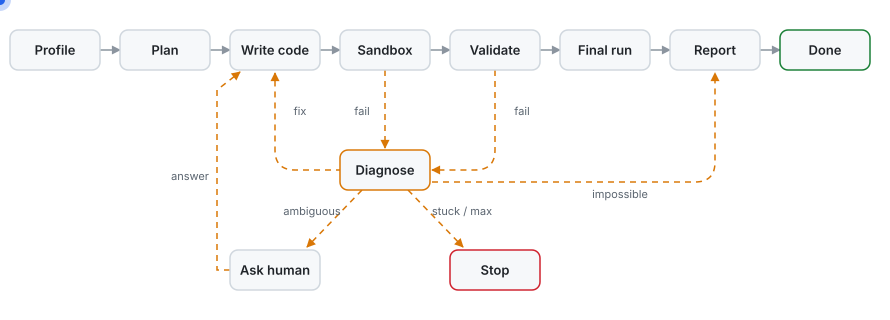

# Makelele

Makelele is a self-correcting data-cleaning agent. You upload a messy CSV or Excel file and describe the shape you want it in; the agent plans the cleaning, writes the pandas code, runs it in an isolated AWS Lambda sandbox, checks the result against your schema and keeps fixing its own code until the file passes, it needs a decision from you, or it gives up.

Built with [LangGraph](https://langchain-ai.github.io/langgraph/), FastAPI and Streamlit.

> **Why "Makelele"?** It's named after Claude Makélélé, the Real Madrid defensive midfielder famous for doing the dirty work so the stars could shine. Cleaning messy data is the same job: unglamorous, essential, and it makes everything after it look good.

# How It Works

<p align="center">
  
</p>

1. **Profile** - decrypts the upload, profiles every column and stores a 500-row sample plus the full file for the sandbox.
2. **Plan** - an LLM proposes a source column for every target column and lists the transformations. Plain code then checks each match: if the names differ once case, spaces, underscores and hyphens are ignored (e.g. `ship_date` -> `order_date`), or no source was found, or the planner raised open questions, the run pauses and shows you the mapping to confirm or correct. Exact name matches (e.g. `Order Date` -> `order_date`) go straight to code writing.
3. **Write code** - an LLM writes a single `transform(data)` function.
4. **Sandbox** - the code runs on the sample inside a Lambda function that can only read its input and write its output.
5. **Validate** - plain Python checks columns, required values, numbers, dates and row count against the schema.
6. **Diagnose** - on failure, an LLM classifies the problem:
   - `fixable` - back to write_code with exact fix instructions
   - `ambiguous` - the run pauses and asks you one question
   - `impossible` - the data can't meet the rule, the run ends with a report
7. **Final run** - the passing code runs once on the full file and is validated again. The cleaned file is encrypted and stored for download.

The loop stops after **6 iterations**, or earlier if the last two attempts didn't reduce the error count. Routing between steps is plain code, never an LLM.

# Security Model

Makelele runs LLM-written code on your data, so it is built around keeping that code boxed in:

- **Encrypted at rest.** Uploads and cleaned files are stored in S3 under `Vault/<job_id>/`, encrypted with AES-GCM. The key lives in AWS Secrets Manager and is used only by the app.
- **Sandboxed execution.** Generated code runs in a separate Lambda function whose IAM role can only read `Sandbox/Input/*` and write `Sandbox/Output/*`. It has no access to the vault or to Secrets Manager.
- **No keys in code.** AWS access uses the default credential chain (your AWS profile locally, the instance's IAM role on EC2). The OpenAI key and encryption key come from Secrets Manager and are cached for an hour.
- **No data in the graph state.** Checkpoints hold only S3 keys, small dicts and numbers, never file contents.

# Quick Start

## Prerequisites
- Python 3.13 and [uv](https://docs.astral.sh/uv/)
- An AWS account with the resources from [AWS Setup](#aws-setup)
- An OpenAI API key

## 1. Install

```bash
git clone https://github.com/rutangpatel/Makelele.git
cd Makelele
uv sync
```

## 2. Configure

Create a `.env` file in the project root:

```
AWS_REGION_NAME=ap-south-1
BUCKET_NAME=your-bucket-name
```

Store the remaining values as one JSON secret named `makelele-secrets` in Secrets Manager:

```json
{
  "OPENAI_API_KEY": "sk-...",
  "OPENAI_MODEL": "your-model-name",
  "file_encryption_key": "<base64 of 32 random bytes>"
}
```

Generate the encryption key with:

```bash
python -c "import os, base64; print(base64.b64encode(os.urandom(32)).decode())"
```

## 3. Run

Start the backend and the frontend in two terminals, both from the project root:

```bash
# Terminal 1 - API
uv run uvicorn api.main:app --host 127.0.0.1 --port 8000

# Terminal 2 - UI
uv run streamlit run ui/app.py
```

Open http://localhost:8501, upload a file, adjust the generated schema and click **Start cleaning**.

# Defining a Schema

The UI drafts a schema from your file's headers. Edit it to describe the clean result:

```json
{
  "columns": {
    "Employee_ID": {"type": "string", "required": true},
    "Age":         {"type": "integer"},
    "Salary":      {"type": "decimal"},
    "Join_Date":   {"type": "date", "format": "%Y-%m-%d"}
  },
  "row_count_preserved": true
}
```

| Field | Meaning |
|---|---|
| `type` | `string`, `integer`, `decimal` or `date` |
| `required` | Empty values fail validation |
| `format` | Expected date format (default `%Y-%m-%d`) |
| `row_count_preserved` | The output must have the same number of rows as the input |

The output must contain exactly the listed columns. Empty strings mean null.

# AWS Setup

| Resource | Purpose |
|---|---|
| S3 bucket | `Vault/` for encrypted files, `Sandbox/Input/` and `Sandbox/Output/` for the sandbox. Prefixes are case-sensitive. |
| Lambda `makelele-sandbox` | Runs [`modules/sandbox/lambda_function.py`](./modules/sandbox/lambda_function.py) (Python with pandas and numpy). Set `BUCKET_NAME` in that file to your bucket. |
| Secret `makelele-secrets` | OpenAI key, model name and encryption key. |

**Lambda execution role** - only `s3:GetObject` on `Sandbox/Input/*` and `s3:PutObject` on `Sandbox/Output/*`. Never give it more.

**App role** (your user locally, the instance role on EC2):

```json
{
  "Version": "2012-10-17",
  "Statement": [
    {
      "Effect": "Allow",
      "Action": ["s3:GetObject", "s3:PutObject"],
      "Resource": [
        "arn:aws:s3:::YOUR-BUCKET/Vault/*",
        "arn:aws:s3:::YOUR-BUCKET/Sandbox/Input/*",
        "arn:aws:s3:::YOUR-BUCKET/Sandbox/Output/*"
      ]
    },
    {
      "Effect": "Allow",
      "Action": "lambda:InvokeFunction",
      "Resource": "arn:aws:lambda:REGION:ACCOUNT-ID:function:makelele-sandbox"
    },
    {
      "Effect": "Allow",
      "Action": ["secretsmanager:GetSecretValue", "secretsmanager:DescribeSecret"],
      "Resource": "arn:aws:secretsmanager:REGION:ACCOUNT-ID:secret:makelele-secrets-*"
    }
  ]
}
```

`DescribeSecret` is required because the secrets cache calls it, not just `GetSecretValue`.

# Deploying on EC2

1. Attach an IAM role with the app policy above to the instance. Don't put access keys on the machine.
2. Copy the project, create `.env` and run `uv sync` in the project folder.
3. Start both services. The commands must run from the project folder, because `.env` and `checkpoints.db` are found relative to it.

```bash
cd ~/Makelele
uv run uvicorn api.main:app --host 127.0.0.1 --port 8000
MAKELELE_API_URL=http://127.0.0.1:8000 uv run streamlit run ui/app.py --server.address 0.0.0.0 --server.port 8501 --server.headless true
```

4. In the security group, open port **8501** to **your IP only**. Keep port 8000 closed: the browser never calls the API directly, Streamlit does.
5. Visit `http://<instance-public-ip>:8501`.

To keep both running after you log out, register them as systemd services. Run uvicorn with a single worker: jobs run as in-process background tasks with SQLite checkpoints, and restarting the API stops any running job.

# API Reference

| Method | Path | Description |
|---|---|---|
| `POST` | `/jobs` | Multipart `file` + `schema` (JSON string). Returns `{"job_id"}`. |
| `GET` | `/jobs/{job_id}` | Status, iteration, attempt history, pending question, stop reason. |
| `POST` | `/jobs/{job_id}/answer` | Form field `answer`. Resumes a job waiting for a human. |
| `GET` | `/jobs/{job_id}/download` | The cleaned CSV, decrypted in memory. |

Job status is one of `running`, `waiting_for_human`, `success`, `partial` or `failed`. Interactive docs are at `http://localhost:8000/docs` while the API runs.

# Project Layout

```
api/main.py                  FastAPI app and job endpoints
core/config.py               .env settings and cached Secrets Manager access
modules/graph/               LangGraph nodes, state and routing
modules/chat_models/         Planner, coder and diagnoser LLM clients
modules/profiler/            File loading and column profiling
modules/sandbox/runner.py    Uploads input and invokes the Lambda
modules/sandbox/lambda_function.py   Code deployed to the Lambda sandbox
modules/storage/vault.py     Encrypted S3 storage
modules/security/            AES-GCM encryption
modules/aws/                 boto3 clients
ui/app.py                    Streamlit frontend
```

# Limitations

- **No authentication.** Anyone who can reach the UI can upload files and download results. Restrict access by IP or put it behind a login before sharing it.
- **Single machine.** Job state lives in a local SQLite file, so the API runs as one process on one instance.
- **Validation is intentionally small.** It checks columns, required values, numeric and date parsing and row count. Business rules beyond that need to be added to `check_schema`.
- **Always review the output.** The agent's code passes your schema, which is not the same as being correct for your data.
